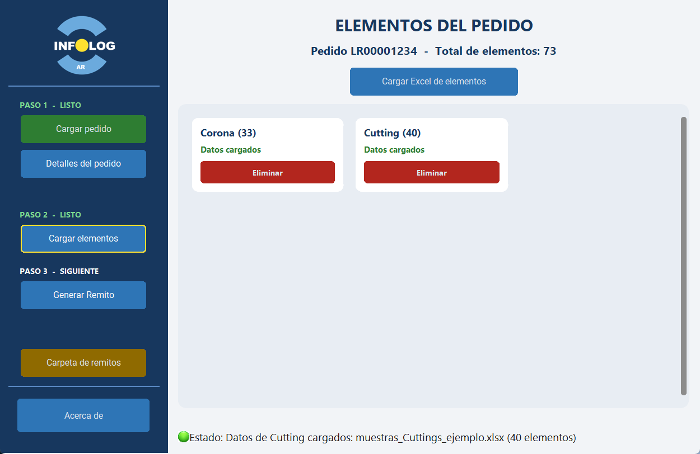
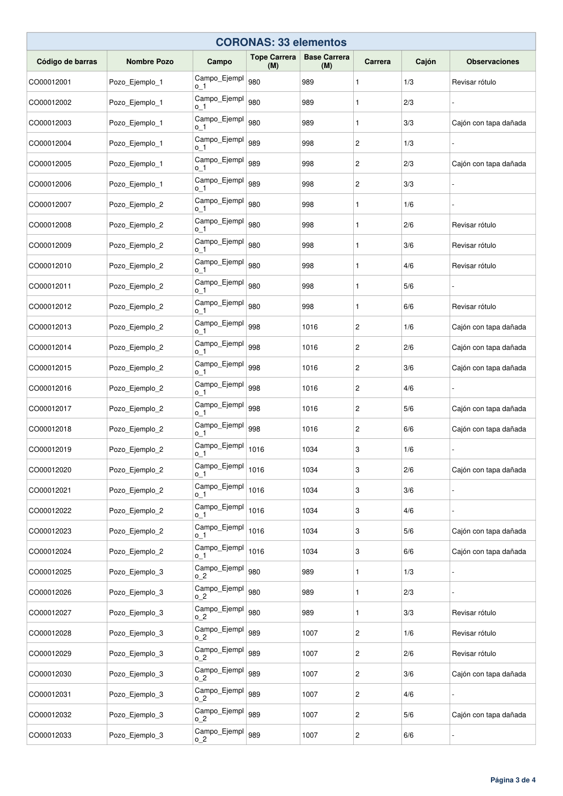

# INFOLOG REMITOS

Aplicación de escritorio desarrollado con asistencia de IA para armar los remitos de préstamos de material de YPF.
Lee el pedido exportado del sistema de YPF (Excel), asocia el detalle de cada
elemento y genera el remito en PDF listo para imprimir y firmar.

Desarrollada por Lucas Jaurena con para INFOLOG S.R.L.

## Uso

El menú indica el avance: cada paso (PASO 1, 2 y 3) muestra "LISTO" cuando
se completa y "SIGUIENTE" cuando es el que toca. El botón de la pantalla en
la que se está queda marcado con un borde amarillo.

1. **Cargar pedido**: seleccionar el Excel del pedido. Se muestran los datos
   del solicitante y del destinatario. Desde ahí se habilita **Detalles del
   pedido**, que vuelve a esta pantalla cuando se quiera.
2. **Cargar elementos**: se habilita una vez cargado el pedido y abre la
   pantalla "Elementos del pedido", que empieza vacía. **Cargar Excel de
   elementos** lee un archivo (una fila por elemento) y crea el recuadro de
   su tipo, que se reconoce por las dos letras de los códigos de barras. Hay
   que cargar un Excel por cada tipo; si se carga otro del mismo tipo,
   reemplaza al anterior. **Quitar**, en cada recuadro, saca ese tipo del
   remito (pide confirmación).
3. **Generar Remito**: se habilita con al menos un tipo cargado. El PDF se
   guarda en la carpeta elegida con **Carpeta de remitos** (por defecto, el
   Escritorio) e indica los tipos incluidos.

Lo que va en el remito sale solo de los Excel de elementos: la columna "IDS
Archivo" del pedido no se usa, porque el sistema del cliente (En este caso YPF) la corta en los pedidos
grandes. La aplicación no controla que estén cargados todos los tipos.

## Tipos de elemento soportados

| Código | Tipo                        | Columnas del remito (en este orden) |
|--------|-----------------------------|-------------------------------------|
| CU     | Cutting                     | Código de barras, Nombre Pozo, Desde, Hasta, Campo, Caja, Observaciones |
| LE     | Legajo de pozo              | Código de barras, Nombre de Pozo, Campo, Observaciones |
| CO     | Corona                      | Código de barras, Nombre Pozo, Campo, Tope Carrera (M), Base Carrera (M), Carrera, Cajón, Observaciones |
| CI     | Cinta sísmica               | Código de barras, Línea, De punto, A punto, Zona, Categoría, Observaciones |
| FM     | Línea sísmica               | Código de barras, Linea, De Punto, A Punto, Zona, Observaciones |
| PA     | Partes de observador        | Código de barras, Linea, De Punto, A Punto, Descripción, Zona, Observaciones |
| IN     | Estudio e informe           | Código de barras, Nombre Pozo, Titulo, Año, Zona, Observaciones |
| CG     | Perfil de control geológico | Código de barras, Nombre Pozo, Tope, Base, Campo, Observaciones |
| PE     | Perfil de pozo              | Código de barras, Nombre Pozo, Tope, Base, Campo, Observaciones |
| FL     | Fluido                      | Código de barras, Nombre Pozo, Tipo De Muestra, Campo, Observaciones |
| MS     | Muestra suelta              | Código de barras, Nombre Pozo, Base Carrera (M), Tope Carrera (M), Campo, Cajón, Observaciones |
| AF     | Afloramiento                | Código de barras, Nombre, Formacion, Cuenca, Contenedor, Observaciones |
| CD     | Corte delgado               | Código de barras, Nombre Pozo, Corte, Profundidad, Campo, Caja, Observaciones |
| CP     | Cutting pet headspace       | Igual que Cutting |
| CL     | Cutting sin lavar           | Igual que Cutting |
| PG     | Plug                        | Código de barras, Nombre Pozo, Numero Identificador, Zona, Caja_Bolsa, Observaciones |
| TE     | Testigo lateral             | Código de barras, Nombre Pozo, Zona, Caja, Observaciones |
| TO     | Taco de petrología orgánica | CODIGO DE BARRA, Nombre Pozo, Campo, Cajón, Observaciones |

Los encabezados se comparan sin tildes ni mayúsculas. En el Excel las columnas
de ubicación traen la posición entre paréntesis ("Caja (8)"); en el remito van
sin ese número. El tipo lo determinan las dos primeras letras del código de
barras, porque varios tipos tienen las mismas columnas.

### Agregar un tipo nuevo

Todo se define en `config.py`, dentro de `CATEGORIAS`:

```python
"XX": Categoria(
    titulo_pdf="NUEVO TIPO",
    columnas=(
        CODIGO_BARRAS,
        Columna("nombre_pozo", NOMBRE_POZO, "Nombre Pozo", 40),
        Columna("campo", CAMPO, "Campo", 30),
    ),
),
```

La clave ("XX") es el prefijo de sus códigos y también tiene que estar en
`TIPOS_ELEMENTOS`, con el nombre que se muestra en la pantalla.

Cada `Columna` indica la clave interna, los nombres aceptados en el Excel, el
título en el PDF y un ancho relativo. Con eso el tipo ya aparece en la
interfaz con su botón de carga y en el remito. El orden de `CATEGORIAS` es el
orden de las secciones en el PDF.

## Estructura

```
main.py                    Punto de entrada
config.py                  Datos de la app, colores y tipos de elemento
excel/
    lector_excel.py        Lee el Excel del pedido
    validador_excel.py     Reglas de negocio del pedido
    lector_elementos.py    Lee los Excel de elementos y detecta su tipo
remitos/
    generador_remito.py    Arma el PDF con ReportLab
interfaz/
    ventana_principal.py   Ventana principal (CustomTkinter)
    componentes.py         Campos de texto copiables
utilidades/
    rutas.py               Rutas de recursos (compatibles con el .exe)
    preferencias.py        Carpeta de remitos elegida por el usuario
    registro.py            Log en archivo
    texto.py               Conversión de celdas de Excel a texto
recursos/imagenes/         Logos e íconos
```

## Desarrollo

Requiere Python 3.10 o superior.

```bat
python -m venv venv
venv\Scripts\activate
pip install -r requirements.txt
python main.py
```

## Generar el .exe portable

```bat
compilar.bat
```

Genera `dist\INFOLOG REMITOS.exe`, un único archivo que funciona en cualquier
Windows sin instalar Python. Los recursos (`recursos/`) quedan dentro del
.exe. Siempre conviene compilar desde un entorno virtual que tenga solo lo que
figura en `requirements.txt`.

## Archivos del usuario

La aplicación guarda su configuración y su log en
`%APPDATA%\INFOLOG REMITOS\`:

- `config.json`: carpeta elegida para los remitos.
- `infolog_remitos.log`: registro de cargas, remitos generados y errores.
  Es lo primero que hay que revisar si algo falla en el .exe, porque no tiene
  consola.

## Capturas

### Datos del pedido


### Elementos del pedido
Cada Excel de elementos que se carga crea la tarjeta de su tipo.


### Remito generado
| Primera hoja | Cambio de tipo | Firma |
|---|---|---|
|  |  |  |

## ¿Le interesa una solución similar?
Adapto esta herramienta a los formatos y procesos de otras empresas.
Contacto: lujaurena_2@yahoo.com.ar 